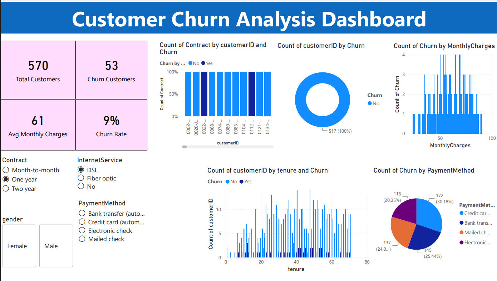

# 📉 Telco Customer Churn Analysis Dashboard (Power BI)

An interactive Power BI dashboard that analyses **7,043 telecom customers** to uncover *who* churns, *when* they churn, and *what* drives it, so a retention team can act on it.




---

## 🎯 Business Problem

Customer churn is one of the most expensive problems in telecom: acquiring a new customer costs far more than retaining an existing one. This dashboard answers:

1. How many customers are we losing, and what does that cost us in monthly revenue?
2. Which contract types, services and payment methods are linked to higher churn?
3. At what point in the customer lifecycle does churn happen?
4. Which customer segments should retention campaigns target first?

---

## 📊 Key Metrics (KPIs)

| KPI | Value |
|---|---|
| Total Customers | **7,043** |
| Churned Customers | **1,869** |
| **Churn Rate** | **26.5%** |
| Avg. Monthly Charges | **$64.76** |

---

## 🔍 Key Insights

| # | Finding | Evidence |
|---|---|---|
| 1 | **Contract type is the strongest churn signal** | Month-to-month churn is **42.7%** vs **11.3%** (1-year) and **2.8%** (2-year). Month-to-month customers make up **~89%** of all churners. |
| 2 | **Churn is front-loaded** | Customers in their first 12 months churn at **47.4%**, falling to **9.5%** after 4 years. **55%** of churners leave within the first year. |
| 3 | **Fiber optic customers are at risk** | **41.9%** churn vs 19.0% for DSL, despite fiber being the premium service (possible pricing or service-quality issue). |
| 4 | **Electronic check is a red flag** | **45.3%** churn vs ~15-17% for automatic bank/credit-card payments. |
| 5 | **Higher bills, higher churn** | Churners pay **$74.44/mo** on average vs **$61.27** for retained customers. |
| 6 | **Support add-ons seem to help retention** | Customers without Tech Support churn at **41.6%** vs **15.2%** with it (a correlation, not proof of causation). |
| 7 | **Gender does not matter** | Female 26.9% vs Male 26.2%, so it can be ignored for targeting. |

### 💡 Recommendations
- Offer discounts or incentives to move **month-to-month → 1/2-year contracts**.
- Build an **onboarding and early-life engagement program** for the first 12 months.
- Nudge **electronic-check users toward auto-pay**.
- Investigate **fiber optic pricing and service quality**.
- Bundle **Tech Support / Online Security** for high-risk segments.

---

## 🖥️ Dashboard Features

- **KPI cards** for Total Customers, Churned Customers, Churn Rate and Avg. Monthly Charges (custom *Advance Card* visual)
- **Churn split donut** (Yes vs No)
- **Churn by contract type** (100% stacked column)
- **Churn by tenure**, with customers grouped by months of tenure and split by churn status
- **Monthly charges distribution** against churn
- **Payment method breakdown** (pie chart)
- **Interactive slicers**: Contract, Internet Service, Payment Method, Gender, so every visual cross-filters instantly

---

## 🛠️ Tech Stack & Skills Demonstrated

| Area | Details |
|---|---|
| **Tool** | Power BI Desktop |
| **Data prep** | Power Query (M): CSV ingestion, header promotion, data typing, null handling |
| **Modeling / DAX** | Custom measures: `COUNTROWS`, `CALCULATE`, `FILTER`, `DIVIDE` |
| **Visualization** | Donut, pie, clustered & 100% stacked columns, slicers, custom visual (Advance Card) |
| **Analysis** | Segmentation, KPI design, churn driver analysis, business storytelling |

---

## 🧹 Data Cleaning & Preparation (Power Query)

- Loaded the raw CSV (21 columns, 7,043 rows) and promoted headers
- Enforced correct data types (`SeniorCitizen`, `tenure` → integer; `MonthlyCharges`, `TotalCharges` → decimal; the rest → text)
- Handled missing `TotalCharges`: the **11 blank values** belong to brand-new customers with `tenure = 0`, so they were replaced with `0`
- Verified there are **no duplicate `customerID`s**

---

## 📐 DAX Measures

```DAX
Total Customers = COUNTROWS('WA_Fn-UseC_-Telco-Customer-Churn')

Churn Customers =
CALCULATE(
    COUNTROWS('WA_Fn-UseC_-Telco-Customer-Churn'),
    FILTER(
        'WA_Fn-UseC_-Telco-Customer-Churn',
        'WA_Fn-UseC_-Telco-Customer-Churn'[Churn] = "Yes"
    )
)

Avg Monthly Charges = AVERAGE('WA_Fn-UseC_-Telco-Customer-Churn'[MonthlyCharges])

Churn Rate = DIVIDE([Churn Customers], [Total Customers], 0)
```

---

## 📁 Repository Structure

```
├── MLBI_CIAP_Dashboard.pbix     # Power BI dashboard file
├── data/
│   └── dashboard.png            # Dashboard screenshot
└── README.md
```

---

## 📦 Dataset

**IBM Telco Customer Churn** dataset (publicly available on Kaggle). Each row is a customer with demographics, subscribed services, account information (contract, billing, payment method, charges) and the churn label.

---

## 🔮 Future Improvements

- Extend into a **predictive churn model in Python** (Logistic Regression, Random Forest, XGBoost) using scikit-learn
- Add a **customer-risk-score** page and a CLV (customer lifetime value) analysis
- Add tenure bands and what-if parameters for retention scenarios
- Publish to **Power BI Service** with a live link

---
